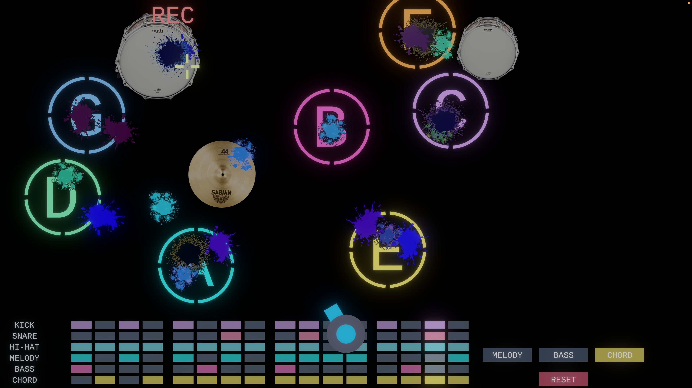

# Shoot Loop

An interactive music looper built with ChucK and ChuGL. Shoot moving targets to play sounds and build loops.

[Watch Demo Video on YouTube](https://www.youtube.com/watch?v=1sUCQeM3lJg)

### Run

Run `shoot.ck` with ChucK and ChuGL installed. Keep the `images` folder next to `shoot.ck`.

### How to Play

1. **Set up your loop.** Before starting, choose the tempo, beats per bar, and number of bars. Click START to begin.
2. **Shoot the targets.** Move your mouse to aim and click to shoot.
3. **Choose an instrument.** Use the MELODY, BASS, and CHORD buttons to switch between different sounds for the letter targets.
4. **Record your performance.** Press R to arm recording. Recording begins at the start of the next loop. Press R again to stop recording.
5. **Build your loop.** Recorded notes are quantized to a 16th-note grid and played back automatically as the loop repeats. Continue adding new layers to develop your music.
6. **Toggle the metronome.** Press M to turn the metronome on or off.
7. **Reset your loop.** Click RESET to clear all recorded notes and start creating a new loop.
